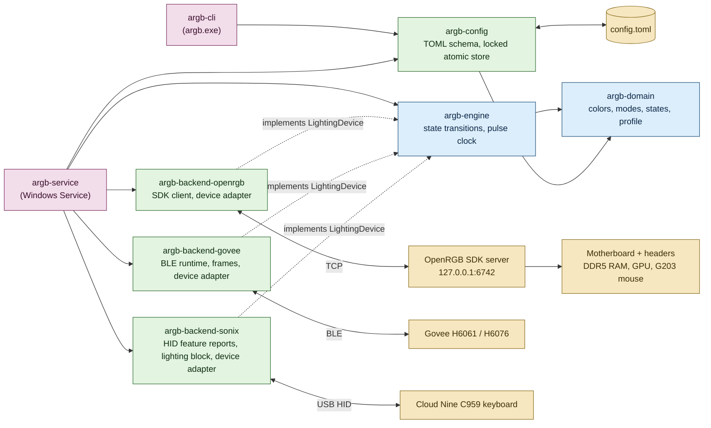
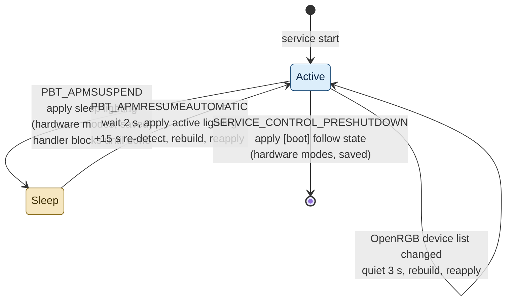

# Architecture

## Overview

The system is a Rust workspace of eight crates arranged by domain. Business
rules sit in the inner crates and know nothing about files, sockets, radios or
Windows. The outer crates adapt those rules to the configuration file, the
OpenRGB SDK, Bluetooth LE, USB HID, the Service Control Manager and the
command line.



## Crates

| Crate | Responsibility | Depends on |
|---|---|---|
| `argb-domain` | `Rgb`, `Brightness`, `PulsePeriod`, `LightingMode`, `PowerState`, `LightingProfile`, `DeviceCapabilities`. Every bound and default lives here as a constant. | serde |
| `argb-config` | Serde mirror of the TOML file, validation, conversion to `LightingProfile`, and `ConfigStore` for locked atomic read-modify-write. | domain |
| `argb-engine` | The `LightingDevice` trait, the `Engine` that applies a state to devices, and the `PulseWaveform` sampled from one clock. | domain |
| `argb-backend-openrgb` | OpenRGB SDK protocol, blocking TCP client, and `LightingDevice` for each OpenRGB controller. | domain, engine |
| `argb-backend-govee` | Govee Bluetooth LE frames and channel cipher, the supported models, a shared Bluetooth runtime with one link per light, `LightingDevice` for each configured light, and the scan behind `argb devices scan`. | domain, engine |
| `argb-backend-sonix` | The Sonix OEM keyboard protocol (feature-report commands, the write session, the lighting block), the supported models by USB id, one HID link per keyboard, `LightingDevice` for each configured keyboard, and the enumeration behind `argb devices scan`. | domain, engine |
| `argb-service` | Windows Service entry point, power event handling, config reload, run loop. | all of the above |
| `argb-cli` | `argb config ...`, `argb devices ...`, `argb apply`, `argb probe-persistence` and `argb service ...` commands. | domain, config, engine, the three backends, service |

## Key decisions

### OpenRGB as the hardware backend

Writing drivers for the ITE USB controller, the Corsair SMBus protocol and the
ASUS I2C protocol would take weeks and require a kernel driver for SMBus.
OpenRGB already has all three, and its PawnIO build uses a signed driver that
the Windows vulnerable-driver blocklist accepts. OpenRGB runs headless as a
service with its SDK server bound to the loopback interface; this project is
its only client.

### Own OpenRGB SDK client

The published `openrgb` crate (0.1.2) is from 2022 and stops at a protocol
version without mode brightness or save-to-device, both of which this project
needs. The protocol is a 16-byte header plus payload, so a client that covers
exactly the packets used here is smaller than adapting the old crate.

### How each mode maps to hardware

| Mode | State | Mechanism | Why |
|---|---|---|---|
| static | active or sleep | Device hardware static mode with hardware brightness where available, saved to device when the persistence policy says so | Survives suspend and boot without the host |
| pulse | active | Direct mode; the engine streams a frame to every pulsing device 30 times a second from one clock | Exact period and perfect synchronization across devices |
| pulse | sleep | Device hardware breathing mode with the nearest supported speed, saved to device | Nothing can stream frames while the host sleeps |

Capabilities per Phase 1 controller as exposed by OpenRGB:

| Controller | Direct | Static with brightness | Hardware pulse | Save to device |
|---|---|---|---|---|
| Gigabyte RGB Fusion 2 USB | yes | yes | Breathing, with speed | yes, explicit save |
| Corsair DRAM | yes | Custom mode, no brightness | Color Pulse, with speed and brightness | automatic on mode change |
| ASUS Aura GPU | yes | yes, no brightness | Breathing | yes, explicit save |

### Power state handling



The service accepts `SERVICE_CONTROL_POWEREVENT`, `PRESHUTDOWN` and
`SHUTDOWN`. On suspend the control handler sends the sleep command and blocks
until the run loop reports the devices updated (or 1.8 s pass), because
Windows may cut power as soon as the handler returns. The sleep profile is
applied unattended: hardware effects only, saved to device memory. On resume
the service waits two seconds for OpenRGB and the buses to come back and
applies the active profile, then 15 s later asks OpenRGB to detect its
hardware again, reconnects and applies once more. The re-detection is
required: OpenRGB keeps the device handles it opened before sleep, and the
Gigabyte board's USB controller no longer answers on them afterwards, so
writes report success while the board shows its firmware rainbow. It must
not come too early either: a re-detection three seconds after waking left
every device unresponsive. OpenRGB announces a changed device list (packet
100) when detection clears the list and again as controllers register, and the
detection-complete packet exists only from protocol 6 (the client speaks 4),
so the re-detection counts as finished when announcements have stopped for
3 s and the list is not empty. If the rebuilt engine maps none of the
configured devices, it is dropped and the service retries every 5 s. On pre-shutdown (or shutdown, when pre-shutdown
is not delivered) it applies the state named by `[boot] follow`, again
unattended and saved, so that POST shows it.

The service also reads the notifications OpenRGB sends on the engine's own
connection at every poll (at least twice a second). A device-list
announcement from any cause starts the same 3 s quiet period, after which
the engine is dropped and rebuilt on the current list and the state
reapplied. The case that demanded it is boot: the two services start in the
same second, the service connects two seconds later, and on the first boot
test OpenRGB was still detecting and listed two of the five controllers (the
RAM sticks). An engine built on that list drove the RAM and nothing else,
and the board showed its firmware lighting until the next sleep cycle. The
same path covers a rescan from the OpenRGB UI and a controller plugged in
while the service runs. A list that maps none of the configured devices is
still refused as above, so the service does not settle on the empty list
that detection starts from.

The engine's `Attendance` captures the distinction: attended applies may use
the synchronized software pulse; unattended applies use each device's own
breathing effect and show the pulse color statically on a device that has
none. `argb apply <state>` runs an unattended apply from the command line to
preview the sleep or boot lighting without suspending the machine.

### Installation

The service has no console, so it logs to a daily file under the `logs`
directory beside the configuration (seven days kept). The service account
can write there; everything else in the configuration directory stays
read-only to it.

`argb service install` copies `argb.exe` and `argb-service.exe` to
`%ProgramFiles%\argb-controller`, writes a starter configuration when none
exists and restricts its directory, then registers the service (automatic
start, `LocalService`, restart on crash three times with a five-second delay)
and starts it. Running it again stops the service, replaces the binaries and
updates the registration, so it doubles as the upgrade path. `uninstall`
stops and unregisters without deleting files. `status` and `check` work from
any prompt; `check` also reports whether the OpenRGB SDK port answers and
whether the configuration parses.

OpenRGB itself is not installed by this project. It must run with its SDK
server on the loopback interface; the service retries the connection every
five seconds, so start order does not matter.

### Persistence probe

`argb probe-persistence` writes a distinct color per device with the
save-to-device policy and prints the assignment. The user then shuts down
fully (Fast Startup would hibernate the kernel instead) and reads the colors
during POST: a device showing its probe color keeps lighting in its own
memory and can carry the boot lighting.

### Persistence policy

Hardware modes are saved to device memory when applying the sleep state and
when applying the state selected by `[boot] follow`. Volatile application is
used otherwise, which spares flash write cycles on the controllers.

### Configuration safety

`ConfigStore` takes an exclusive lock on a sidecar lock file, writes the new
document to a temporary file in the same directory, flushes it, then renames
it over the old file. Readers see either the old or the new document, never a
mix. The CLI performs every edit as a locked read-modify-write.

### Device matching

At connection time the service lists the controllers OpenRGB reports and
pairs each one with an alias:

1. The first configured device whose `backend` is `openrgb` and whose
   `match_name` is a case-insensitive substring of the reported name claims
   the controller. A configured alias claims at most one controller; a
   configured device that matches nothing is logged.
2. Any other controller gets an alias derived from its reported name
   (lower-cased, runs of punctuation and spaces collapsed to `-`, truncated
   to the alias length limit, suffixed `-2`, `-3`, ... when it collides).
   Such a device has no overrides, so it follows the state defaults.

`argb devices list` prints this pairing together with each controller's
capabilities, so the user can see what a `match_name` resolves to before
relying on it. The same code path will feed `argb devices scan`.

The adapter resolves a controller's modes by name: `Direct` for streaming,
`Static` or `Custom` for the hardware static mode, and `Breathing`, `Color
Pulse` or `Pulse` for the hardware pulse. Capabilities follow from the flags
of those modes: hardware brightness when the static mode has a brightness
range, persistent memory when either mode is saveable (explicitly or
automatically). A mode that saves automatically receives a plain update even
under the save-to-device policy, since a save packet would be rejected.

Three rules come from the first run against the real machine:

- A static or breathing mode only qualifies when it can carry a color
  (per-LED array or at least one mode-specific slot). The Logitech G203
  advertises `Static` and `Breathing` modes with neither, an OpenRGB
  driver defect the server's validation turns into a black light (see
  `docs/phase2-1-peripherals.md`); such a device falls back to Direct for
  static and to the static fallback for the pulse.
- The server validates every mode update against the mode's declared
  ranges and rejects the whole update otherwise, so the adapter never sends
  more colors than `colors_max` and keeps speed and brightness in range.
- When a hardware static mode stores per-LED colors in the controller
  (Corsair DRAM over SMBus), the color write must not follow the mode
  commit immediately: the chip is still busy and the write fails its
  checksum, leaving the default white. The adapter waits half a second
  between the two. OpenRGB's own window never hits this because a person
  separates the two clicks.

Zone sizes are OpenRGB's responsibility. The board's ARGB header zones
report zero LEDs until sized in OpenRGB (which stores the sizes), and
OpenRGB drives nothing on a zero-sized zone, so the fans and AIO stay dark
until then.

### Connection lifecycle

The service connects to OpenRGB at start and retries every 5 seconds until
the SDK server answers, so start order between the two services does not
matter. The engine holds the OpenRGB controllers, the configured Govee
lights and the configured keyboards behind one `Box<dyn LightingDevice>`
list, and the service sorts backend errors by the backend the failing alias
belongs to. An OpenRGB error while applying a state or streaming a pulse
frame means the server connection is gone: the service drops it, and the
next poll reconnects and reapplies the desired state. A Govee or Sonix
error means one light is off, out of range or busy, or a keyboard is
unplugged: the engine remembers which devices failed, and the service
retries those alone 10 seconds later, while the rest keep their state. The
configuration file's modification time is checked once a second; a change
reloads the profile and reapplies, and a change to the `[openrgb]` section
reconnects.

### Govee lights over Bluetooth LE

Each configured `govee_ble` device is one `GoveeDevice` over a `BleLink`.
The links share one `BleRuntime`: a single-threaded Tokio runtime owning the
first Bluetooth adapter, created on the first use and kept for the life of
the engine. The engine's calls stay synchronous; each one blocks on the
runtime for the duration of the Bluetooth exchange.

A link finds its light by advertised name, from the adapter's cache first
and then from a 5 second scan, so a light that is off when the service
starts is picked up by the retry once it is powered. The advertisement's
manufacturer data says whether the light uses the encrypted channel; if so
the link runs the handshake after connecting and ciphers every later frame
with the session key. Replies arrive as notifications and are drained after
each write; the handshake has a 6 second timeout.

A static apply is one short connection: power on, color, brightness when it
changed since the last write (the light flashes on a brightness write),
then disconnect. The light keeps the state on its own, including across a
power cycle, so `Persist` needs no action and the sleep lighting written
before suspend is what the light shows while the PC is off. Direct mode
(the software pulse) keeps the link open and writes a color frame at most
every 100 ms; the engine still ticks at 30 Hz, so the light samples the
same waveform at its own rate. Neither light has a breathing effect of its
own, so the hardware pulse falls back to the pulse color shown statically,
the engine's existing rule. The frames, the AES/RC4 channel cipher, the
pre-shared key and the per-model segment masks are documented with their
sources in `docs/phase2-govee-ble.md`.

### Sonix keyboards over USB HID

Each configured `sonix` device is one `SonixDevice` over a `HidLink`. The
link opens the keyboard's control collection (the plain keyboard collection
on interface 0) through `hidapi` on first use and keeps the handle; a
failed write drops it, so the next apply enumerates again and finds a
replugged keyboard. Nothing is opened at engine build time, so a keyboard
unplugged at service start is picked up by the retry.

Every apply is one write session of the keyboard's 18-page lighting block:
begin, select the lighting section, the pages, commit, apply, each command
acknowledged by the keyboard's echo and retried up to three times, with
the 35 ms pacing the vendor application keeps. The block carries the
application's presets, a black per-key table and the active record for
the configured mode: the static effect at the brightness level nearest to
the percentage (zero percent leaves the active record empty, which is how
the keyboard turns its LEDs off), or the breathing effect at a speed
derived from the pulse period. The firmware stores the block in flash and
keeps it across a power cycle, so `Persist` needs no action, the block is
written only when it differs from the last one written, and the device
advertises no direct mode: a session takes close to a second and the
flash would not survive the pulse tick rate. The sleep pulse therefore
always uses the keyboard's own breathing effect. The protocol, its sources
and the capture it was read from are in `docs/phase2-1-peripherals.md`.

### Configuration reload

The service watches the configuration file and, when it changes, drops its
engine and rebuilds it from the new configuration and the server's current
device list, then reapplies the current state. This keeps the CLI decoupled
from the service: the CLI needs no control channel, and a hand edit works
the same way. Rebuilding rather than swapping the profile means a changed
selector or a device added by `argb devices scan` takes effect without a
restart, at the cost of one loopback reconnection.

### Device discovery

`argb devices scan` runs the same matching as the service, keeps every
controller no configured device claims, and appends an entry for each:
alias derived from the reported name, `match_name` set to the full reported
name, no overrides. New devices therefore follow the state defaults until
the user tunes them (`argb config rename-device`, `set-device-mode`). Two
controllers with the same name (the two RAM sticks) get the same
`match_name` and distinct aliases; the service binds them in index order,
which is stable for fixed hardware. `--rescan` first asks OpenRGB to detect
hardware again and waits for its device-list notification, for hardware
plugged in since OpenRGB started; `--dry-run` prints without writing.

The same command then enumerates the supported keyboards plugged in and
appends an entry for each one no configured device matches
(`backend = "sonix"`, `match_name` set to the reported name, which is the
model name followed by the USB id), then listens for Govee lights over
Bluetooth LE for 8 seconds and appends an entry (`backend = "govee_ble"`,
`match_name` set to the advertised name) for each supported model no
configured device matches; other Govee lights are listed as unsupported.
`argb devices list` shows the keyboards plugged in and the lights heard
with their model, support and channel. `--no-bluetooth` skips the scan, and
a machine without a Bluetooth adapter gets a note rather than a failure.

## Security

Reviewed in Phase 2.5 (2026-11-01) over every crate and the installed setup
on the reference machine. The review asked three questions: what can an
unprivileged local process do to the service, what can a device in radio or
USB range do, and what does the service give up if it is compromised.

### Trust boundaries

| Boundary | Who is on the other side | Reaches the service through |
|---|---|---|
| Configuration file | Administrators only (directory ACL, inheritance cut) | TOML parsed with `deny_unknown_fields`, validated, data only |
| OpenRGB SDK socket, `127.0.0.1:6742` | The OpenRGB service (LocalSystem), or any local process when OpenRGB is not listening, since the SDK has no authentication | Packet headers and controller descriptions parsed by `argb-backend-openrgb` |
| Bluetooth LE | Any device in range: the lights pair with nothing, and anything can advertise a light's name | Advertisements and notifications parsed by `argb-backend-govee` |
| USB HID | Whatever enumerates as a supported keyboard | 65-byte feature reports read by `argb-backend-sonix` |
| Dependencies | crates.io | `Cargo.lock`, checked with `cargo audit` |

### Findings and fixes

| # | Finding | Severity | Fix |
|---|---|---|---|
| 1 | The SDK client allocated a packet's payload from the `u32` length in its header before reading it. A process squatting the SDK port while OpenRGB is down could make the service commit up to 4 GiB per packet and crash it; after three crashes in a day the Service Control Manager stops restarting it. | Medium (local denial of service) | `Header::decode` refuses a payload above `MAX_PAYLOAD_LEN` (16 MiB, far above any controller description); both receive paths go through it. |
| 2 | A mode update took its color count from the server's `colors_min`/`colors_max` (`u32`) and built a vector of that size; a hostile server could make it allocate gigabytes or panic in the `u16` length encoder. | Medium (local denial of service) | `colorize` bounds the count by `MAX_MODE_COLORS` (the `u16` the wire format carries). |
| 3 | `time` 0.3.45 in `Cargo.lock` has a published denial-of-service advisory (RUSTSEC-2026-0009, stack exhaustion when parsing). The project never parses dates with it, but the fix is a version bump. | Low | `time` 0.3.47; the workspace's minimum Rust is 1.88 as that version requires. `cargo audit` is part of the checks in `docs/contributing.md`. |
| 4 | The service process carried every privilege of the `LocalService` account, impersonation included, which a compromise could use to climb to SYSTEM. It needs none of them. | Low (defense in depth) | `argb service install` sets the required-privileges list to `SeChangeNotifyPrivilege` only, through `sc.exe privs`; the Service Control Manager strips the rest from the process token. |
| 5 | The installer ran `icacls` by name, resolved through the search path, from an elevated process. | Low | System tools run by absolute path under the Windows system folder (`system_tool`). |
| 6 | Names reported by the OpenRGB server and advertised over Bluetooth were logged with `Display` and printed to the terminal unescaped, so a hostile peer could inject log lines or terminal escape sequences. | Low | Peer names are logged with `Debug` (escaped) and the CLI replaces control characters before printing. |
| 7 | A non-loopback `openrgb.host` would drive lighting across the network in the clear, with no warning. | Informational | `argb service check` warns when the host is not a loopback address. |

After the fixes `cargo audit` reports no advisory, and the parsing of every
peer-supplied length is bounded: strings and element counts in controller
descriptions are `u16` on the wire, the matrix map is read from a `u16`-sized
slice, Govee notifications are handled frame by frame and discarded when
nobody waits for them, and the keyboard echo is a fixed 65-byte report.

### Accepted risks

- **The SDK has no authentication.** Any local process can drive the lighting
  through OpenRGB directly, or impersonate the server to this service while
  OpenRGB is down, which at most leaves the lighting unmanaged until OpenRGB
  is back. OpenRGB runs as LocalSystem by its own installer; its exposure to
  local clients is its own, and nothing in this project widens it.
- **The lights accept anyone in range.** Govee's "encrypted" channel runs
  under a published pre-shared key, so it hides nothing and authenticates
  nobody. A neighbour can set the lights, or advertise a light's name so
  the service talks to them instead; the service then writes colors to the
  wrong peer and logs a failure, nothing more.
- **Log files are readable by local users.** They hold device names, aliases
  and timings, no secrets; the service account can write only there.
- **`argb apply` and `argb devices` run as the invoking user** and talk to
  the devices directly, which is no more than any user can already do
  through OpenRGB or Bluetooth.

### What the setup relies on

- The service runs as `NT AUTHORITY\LocalService` with one privilege, from
  a binary under the program files folder registered with a quoted path.
- The configuration directory under the machine-wide program data folder is
  writable by administrators and SYSTEM only, readable by the service
  account and local users; `argb service install` sets the ACL with
  `icacls` by well-known SIDs, so `argb config ...` writes need an elevated
  prompt and the service never executes anything from the file.
- Writes replace the file atomically under an advisory lock, so the service
  never reads a half-written document.
- The Govee session key lives in memory only; the configuration holds
  advertised names, never addresses.
- The keyboard backend opens the keyboard's own HID collection, which
  Windows lets any process do for feature reports; it writes the lighting
  block and reads the keyboard's echo of its commands, never key input (the
  input reports go to the system's keyboard driver, which `hidapi` cannot
  read). Every write replaces the whole block with values the backend
  builds, so nothing from the configuration reaches the keyboard but a
  color, a brightness level and a speed.
- No `unsafe` code in project crates; the lint forbids it at the workspace
  level.

## Repository layout

```
Cargo.toml              workspace
config.example.toml     documented example configuration (also parsed by tests)
crates/
  argb-domain/
  argb-config/
  argb-engine/
  argb-backend-openrgb/
  argb-backend-govee/
  argb-backend-sonix/
  argb-sonix-probe/     console spike over the Sonix backend, for protocol experiments
  argb-service/
  argb-cli/
docs/
  requirements.md
  architecture.md
  contributing.md
  phase2-govee-ble.md   Govee protocol facts, spike results, backend design
  phase2-1-peripherals.md   G203 findings and workaround, C959 keyboard protocol and capture notes
```

## Milestones

1. **Scaffold** (done): workspace, domain, config store, engine, protocol client, service and CLI skeletons, all unit tested.
2. **Static color end to end** (done): controller descriptions and mode/LED updates over the SDK protocol, the `LightingDevice` adapter for OpenRGB, controller-to-alias matching, a service runtime that connects with retry, applies the active profile and follows the configuration file; `argb devices list`.
3. **Device discovery** (done, [issue 2](https://github.com/Kalisen/argb-controller/issues/2)): `argb devices scan` compares the controllers the backends report with the configured devices, appends a default entry for each new one (alias derived from the reported name, no overrides), and the running service applies the result through the configuration reload.
4. **Sleep and boot** (done): synchronous suspend handling, pre-shutdown boot lighting, unattended applies, `argb apply`, `argb probe-persistence`.
5. **Synchronized pulse** (done): direct-mode streaming at 30 Hz with one clock.
6. **Installer** (done): `argb service install|uninstall|start|stop|status|check`, directory ACL, OpenRGB reachability check.
7. **Phase 2** (done): Govee BLE backend. A spike settled the protocol, the encrypted channel and Bluetooth from session 0 (`docs/phase2-govee-ble.md`); the `argb-backend-govee` crate drives the Glide Hexa and the Lyra lamp from the service and the CLI, `argb devices scan` adds them, and failed lights are retried without dropping OpenRGB.
8. **Phase 2.1** (in progress): the G203's static color is an OpenRGB driver defect (`colors_max` left at zero) that the SDK cannot work around; the adapter now also refuses a breathing mode that cannot carry a color, and the fix is reported upstream. The Cloud Nine C959 is a Sonix keyboard (`0C45:8008`) whose vendor application writes an 18-page lighting block over HID feature reports; a USB capture settled the layout and `argb-backend-sonix` drives the static color, brightness and breathing effect from the service and the CLI (`docs/phase2-1-peripherals.md`). Left to verify on the machine: the keyboard during sleep and POST, and the breathing speed scale.
9. **Phase 2.5** (done): security review of every crate and of the installed setup; seven findings, all fixed (bounded SDK payload and mode-color sizes, the `time` advisory, a one-privilege service process, system tools by absolute path, escaped peer names, a loopback check), see "Security".
10. **Phase 3**: Samsung monitor investigation.
