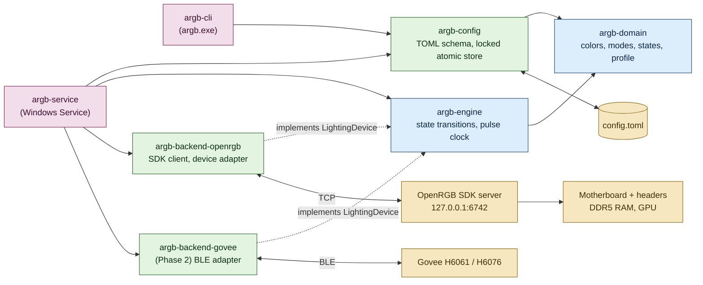
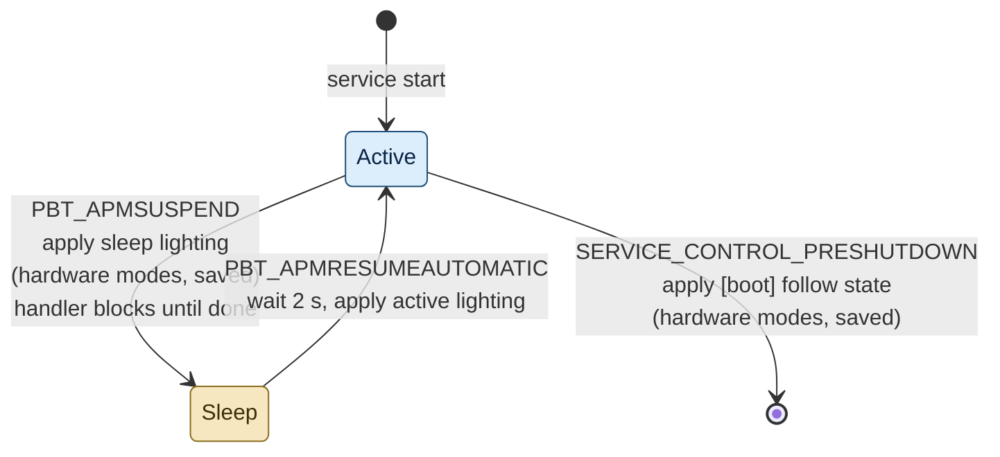

# Architecture

## Overview

The system is a Rust workspace of six crates arranged by domain. Business rules
sit in the inner crates and know nothing about files, sockets or Windows. The
outer crates adapt those rules to the configuration file, the OpenRGB SDK, the
Service Control Manager and the command line.



## Crates

| Crate | Responsibility | Depends on |
|---|---|---|
| `argb-domain` | `Rgb`, `Brightness`, `PulsePeriod`, `LightingMode`, `PowerState`, `LightingProfile`, `DeviceCapabilities`. Every bound and default lives here as a constant. | serde |
| `argb-config` | Serde mirror of the TOML file, validation, conversion to `LightingProfile`, and `ConfigStore` for locked atomic read-modify-write. | domain |
| `argb-engine` | The `LightingDevice` trait, the `Engine` that applies a state to devices, and the `PulseWaveform` sampled from one clock. | domain |
| `argb-backend-openrgb` | OpenRGB SDK protocol, blocking TCP client, and `LightingDevice` for each OpenRGB controller. | domain, engine |
| `argb-service` | Windows Service entry point, power event handling, config reload, run loop. | all of the above |
| `argb-cli` | `argb config ...` commands. Only talks to `argb-config`. | domain, config |

## Key decisions

### OpenRGB as the hardware backend

Writing drivers for the ITE USB controller, the Corsair SMBus protocol and the
ASUS I2C protocol would take weeks and require a kernel driver for SMBus.
OpenRGB already has all three, and its PawnIO build uses a signed driver that
the Windows vulnerable-driver blocklist accepts. OpenRGB runs headless as a
service with its SDK server bound to the loopback interface; this project is
its only client.

### Own OpenRGB SDK client

The published `openrgb` crate (0.1.2) is from 2022 and stops at a protocol
version without mode brightness or save-to-device, both of which this project
needs. The protocol is a 16-byte header plus payload, so a client that covers
exactly the packets used here is smaller than adapting the old crate.

### How each mode maps to hardware

| Mode | State | Mechanism | Why |
|---|---|---|---|
| static | active or sleep | Device hardware static mode with hardware brightness where available, saved to device when the persistence policy says so | Survives suspend and boot without the host |
| pulse | active | Direct mode; the engine streams a frame to every pulsing device 30 times a second from one clock | Exact period and perfect synchronization across devices |
| pulse | sleep | Device hardware breathing mode with the nearest supported speed, saved to device | Nothing can stream frames while the host sleeps |

Capabilities per Phase 1 controller as exposed by OpenRGB:

| Controller | Direct | Static with brightness | Hardware pulse | Save to device |
|---|---|---|---|---|
| Gigabyte RGB Fusion 2 USB | yes | yes | Breathing, with speed | yes, explicit save |
| Corsair DRAM | yes | Custom mode, no brightness | Color Pulse, with speed and brightness | automatic on mode change |
| ASUS Aura GPU | yes | yes, no brightness | Breathing | yes, explicit save |

### Power state handling



The service accepts `SERVICE_CONTROL_POWEREVENT`, `PRESHUTDOWN` and
`SHUTDOWN`. On suspend the control handler sends the sleep command and blocks
until the run loop reports the devices updated (or 1.8 s pass), because
Windows may cut power as soon as the handler returns. The sleep profile is
applied unattended: hardware effects only, saved to device memory. On resume
the service waits two seconds for OpenRGB and the buses to come back and
applies the active profile, then 15 s later asks OpenRGB to detect its
hardware again, reconnects and applies once more. The re-detection is
required: OpenRGB keeps the device handles it opened before sleep, and the
Gigabyte board's USB controller no longer answers on them afterwards, so
writes report success while the board shows its firmware rainbow. It must
not come too early either: a re-detection three seconds after waking left
every device unresponsive. OpenRGB announces a changed device list (packet
100) when detection clears the list and again as controllers register, and the
detection-complete packet exists only from protocol 6 (the client speaks 4),
so the re-detection counts as finished when announcements have stopped for
3 s and the list is not empty. If the rebuilt engine maps none of the
configured devices, it is dropped and the service retries every 5 s. On pre-shutdown (or shutdown, when pre-shutdown
is not delivered) it applies the state named by `[boot] follow`, again
unattended and saved, so that POST shows it.

The engine's `Attendance` captures the distinction: attended applies may use
the synchronized software pulse; unattended applies use each device's own
breathing effect and show the pulse color statically on a device that has
none. `argb apply <state>` runs an unattended apply from the command line to
preview the sleep or boot lighting without suspending the machine.

### Installation

The service has no console, so it logs to a daily file under the `logs`
directory beside the configuration (seven days kept). The service account
can write there; everything else in the configuration directory stays
read-only to it.

`argb service install` copies `argb.exe` and `argb-service.exe` to
`%ProgramFiles%rgb-controller`, writes a starter configuration when none
exists and restricts its directory, then registers the service (automatic
start, `LocalService`, restart on crash three times with a five-second delay)
and starts it. Running it again stops the service, replaces the binaries and
updates the registration, so it doubles as the upgrade path. `uninstall`
stops and unregisters without deleting files. `status` and `check` work from
any prompt; `check` also reports whether the OpenRGB SDK port answers and
whether the configuration parses.

OpenRGB itself is not installed by this project. It must run with its SDK
server on the loopback interface; the service retries the connection every
five seconds, so start order does not matter.

### Persistence probe

`argb probe-persistence` writes a distinct color per device with the
save-to-device policy and prints the assignment. The user then shuts down
fully (Fast Startup would hibernate the kernel instead) and reads the colors
during POST: a device showing its probe color keeps lighting in its own
memory and can carry the boot lighting.

### Persistence policy

Hardware modes are saved to device memory when applying the sleep state and
when applying the state selected by `[boot] follow`. Volatile application is
used otherwise, which spares flash write cycles on the controllers.

### Configuration safety

`ConfigStore` takes an exclusive lock on a sidecar lock file, writes the new
document to a temporary file in the same directory, flushes it, then renames
it over the old file. Readers see either the old or the new document, never a
mix. The CLI performs every edit as a locked read-modify-write.

### Device matching

At connection time the service lists the controllers OpenRGB reports and
pairs each one with an alias:

1. The first configured device whose `backend` is `openrgb` and whose
   `match_name` is a case-insensitive substring of the reported name claims
   the controller. A configured alias claims at most one controller; a
   configured device that matches nothing is logged.
2. Any other controller gets an alias derived from its reported name
   (lower-cased, runs of punctuation and spaces collapsed to `-`, truncated
   to the alias length limit, suffixed `-2`, `-3`, ... when it collides).
   Such a device has no overrides, so it follows the state defaults.

`argb devices list` prints this pairing together with each controller's
capabilities, so the user can see what a `match_name` resolves to before
relying on it. The same code path will feed `argb devices scan`.

The adapter resolves a controller's modes by name: `Direct` for streaming,
`Static` or `Custom` for the hardware static mode, and `Breathing`, `Color
Pulse` or `Pulse` for the hardware pulse. Capabilities follow from the flags
of those modes: hardware brightness when the static mode has a brightness
range, persistent memory when either mode is saveable (explicitly or
automatically). A mode that saves automatically receives a plain update even
under the save-to-device policy, since a save packet would be rejected.

Three rules come from the first run against the real machine:

- A static mode only qualifies when it can carry a color (per-LED array or
  at least one mode-specific slot). The Logitech G203 advertises a `Static`
  mode with neither; selecting it just turns the light off, so such a
  device falls back to Direct.
- The server validates every mode update against the mode's declared
  ranges and rejects the whole update otherwise, so the adapter never sends
  more colors than `colors_max` and keeps speed and brightness in range.
- When a hardware static mode stores per-LED colors in the controller
  (Corsair DRAM over SMBus), the color write must not follow the mode
  commit immediately: the chip is still busy and the write fails its
  checksum, leaving the default white. The adapter waits half a second
  between the two. OpenRGB's own window never hits this because a person
  separates the two clicks.

Zone sizes are OpenRGB's responsibility. The board's ARGB header zones
report zero LEDs until sized in OpenRGB (which stores the sizes), and
OpenRGB drives nothing on a zero-sized zone, so the fans and AIO stay dark
until then.

### Connection lifecycle

The service connects to OpenRGB at start and retries every 5 seconds until
the SDK server answers, so start order between the two services does not
matter. Any backend error while applying a state or streaming a pulse frame
drops the connection, and the next poll reconnects and reapplies the desired
state. The configuration file's modification time is checked once a second;
a change reloads the profile and reapplies, and a change to the `[openrgb]`
section reconnects.

### Configuration reload

The service watches the configuration file and, when it changes, drops its
engine and rebuilds it from the new configuration and the server's current
device list, then reapplies the current state. This keeps the CLI decoupled
from the service: the CLI needs no control channel, and a hand edit works
the same way. Rebuilding rather than swapping the profile means a changed
selector or a device added by `argb devices scan` takes effect without a
restart, at the cost of one loopback reconnection.

### Device discovery

`argb devices scan` runs the same matching as the service, keeps every
controller no configured device claims, and appends an entry for each:
alias derived from the reported name, `match_name` set to the full reported
name, no overrides. New devices therefore follow the state defaults until
the user tunes them (`argb config rename-device`, `set-device-mode`). Two
controllers with the same name (the two RAM sticks) get the same
`match_name` and distinct aliases; the service binds them in index order,
which is stable for fixed hardware. `--rescan` first asks OpenRGB to detect
hardware again and waits for its device-list notification, for hardware
plugged in since OpenRGB started; `--dry-run` prints without writing.

## Security considerations

These are the inputs to the Phase 2.5 review.

- The OpenRGB SDK has no authentication. The service connects only to the
  loopback address; the configuration schema defaults to it and the
  documentation says why.
- The service runs as `NT AUTHORITY\LocalService`: it needs only the
  loopback network and read access to the configuration, and power events
  reach every service regardless of account. It must not execute anything
  from the configuration file: the file holds data only, and
  `deny_unknown_fields` rejects anything unexpected.
- The configuration directory under the machine-wide program data folder is
  writable by administrators and SYSTEM only, readable by the service
  account and local users, with inheritance cut. `argb service install`
  sets this ACL with `icacls` using well-known SIDs, so an unprivileged
  process cannot make the service change lighting or crash on malformed
  input, and `argb config ...` writes need an elevated prompt.
- The binaries are copied to the program files folder, which is already
  protected, so the registered service path cannot be swapped by a user.
- Bluetooth pairing material for Phase 2 is stored outside the repository and
  outside the configuration file.
- No `unsafe` code in project crates; the lint forbids it at the workspace level.

## Repository layout

```
Cargo.toml              workspace
config.example.toml     documented example configuration (also parsed by tests)
crates/
  argb-domain/
  argb-config/
  argb-engine/
  argb-backend-openrgb/
  argb-service/
  argb-cli/
docs/
  requirements.md
  architecture.md
  contributing.md
```

## Milestones

1. **Scaffold** (done): workspace, domain, config store, engine, protocol client, service and CLI skeletons, all unit tested.
2. **Static color end to end** (done): controller descriptions and mode/LED updates over the SDK protocol, the `LightingDevice` adapter for OpenRGB, controller-to-alias matching, a service runtime that connects with retry, applies the active profile and follows the configuration file; `argb devices list`.
3. **Device discovery** (done, [issue 2](https://github.com/Kalisen/argb-controller/issues/2)): `argb devices scan` compares the controllers the backends report with the configured devices, appends a default entry for each new one (alias derived from the reported name, no overrides), and the running service applies the result through the configuration reload.
4. **Sleep and boot** (done): synchronous suspend handling, pre-shutdown boot lighting, unattended applies, `argb apply`, `argb probe-persistence`.
5. **Synchronized pulse**: direct-mode streaming at 30 Hz with one clock.
6. **Installer** (this branch): `argb service install|uninstall|start|stop|status|check`, directory ACL, OpenRGB reachability check.
7. **Phase 2**: Govee BLE backend.
8. **Phase 2.1**: Logitech G203 through OpenRGB (fix the static color), Cloud Nine C959 keyboard feasibility and backend if a protocol is available.
9. **Phase 2.5**: security review and fixes.
10. **Phase 3**: Samsung monitor investigation.
